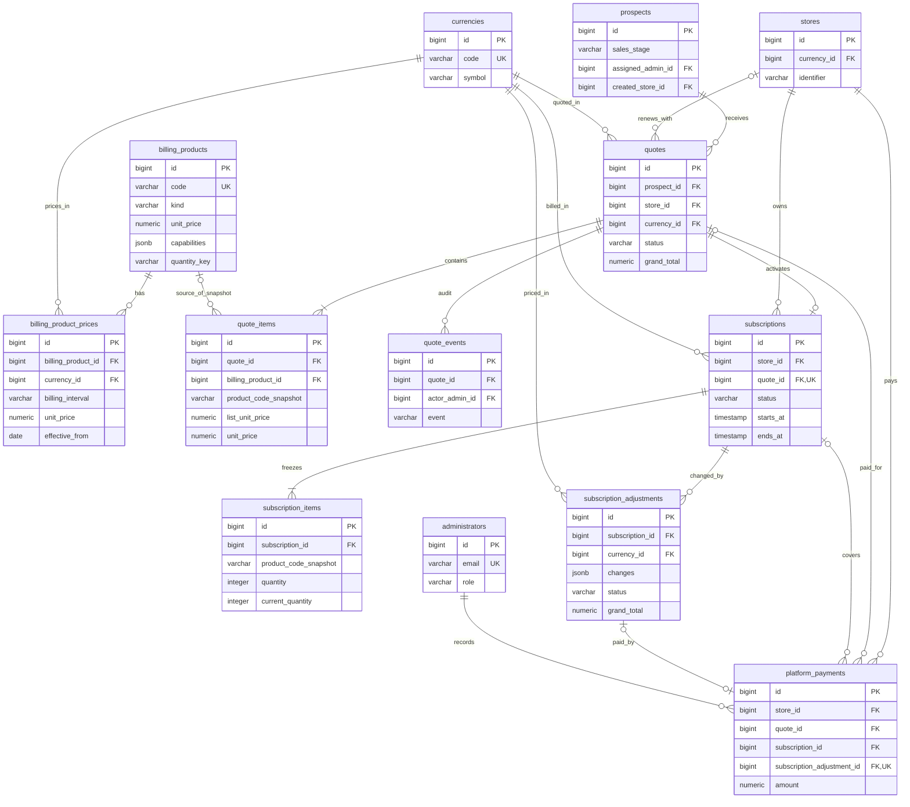

# Sufra Products / Billing — المخطط الحالي

هذه لقطة من migrations والموديلات في `sufra-api` بتاريخ 2026-09-27، وليست قراءة
مباشرة من قاعدة staging أو production. افتح ER Atlas واختر مساحة
**Sufra · Products الحالي**؛ فيها 13 جدولًا و207 أعمدة و30 علاقة FK، مع مواضيع
للكتالوج، العروض، الاشتراكات، والمدفوعات. يمكن اقتراح التعديلات كمسودة دون تغيير
قاعدة البيانات.

المخطط النصي يبرز علاقات البيع فقط. مساحة ER Atlas تعرض كذلك كل علاقات
المسؤولين والعملات، والأعمدة التفصيلية للخصومات والضرائب وحالات الاعتماد.
`stores` و`administrators` معروضان كجداول طرفية مختصرة؛ باقي حقولهما خارج نطاق
المنتجات. لا توجد جداول لرخص الأجهزة المقترحة هنا.

## نقاط تستحق النقاش

1. **مصدر السعر:** لدى `billing_products` سعر عام وحقول سعر فترة قديمة، وفي
   المقابل `billing_product_prices` حسب العملة والفترة. أيها المصدر المعتمد؟
   العرض يقبل الرجوع للسعر العام، لكن تعديل الاشتراك يحتاج سعر الفترة/العملة.
2. **ثبات العقد:** `quote_items` يحتفظ بنسخة المنتج وله FK اختياري للكتالوج؛
   `subscription_items` يحتفظ بنسخة تعاقدية بلا FK للمنتج. تغيير المنتج لاحقًا
   لا ينبغي أن يعيد كتابة عقد سابق.
3. **التعديل أثناء الفترة:** ليس له جدول `adjustment_items`؛ تفاصيل التغيير داخل
   `subscription_adjustments.changes` من نوع JSONB، بينما `current_quantity`
   في `subscription_items` تمثل الحالة الجارية. هل هذا كافٍ للتقارير والتدقيق؟
4. **التجديد:** العرض الجديد ينشئ صفًا جديدًا في `subscriptions` للفترة القادمة؛
   لا يمدد الصف القديم. العلاقة `quotes` ← `subscriptions` واحد إلى صفر/واحد.
5. **الدفع:** `platform_payments` يرتبط بالمتجر والعملات والمسؤول، وقد يرتبط
   بعرض/اشتراك أو بتعديل اشتراك. حقل `subscription_adjustment_id` فريد، أي
   دفعة واحدة كحد أقصى لكل تعديل في النموذج الحالي.

المصادر الأساسية: `sufra-api/database/migrations/2026_09_08_000002_create_billing_catalog_tables.php`،
`2026_09_08_000003_create_quotes_tables.php`،
`2026_09_08_000005_create_subscriptions_tables.php`،
`2026_09_12_000001_create_subscription_adjustments_table.php`،
مع migrations اللاحقة للحقول وإعادة التسمية.
